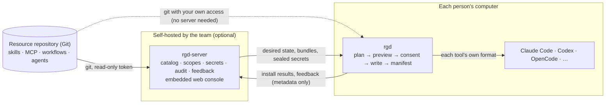

<p align="center">
  <picture>
    <source media="(prefers-color-scheme: dark)" srcset="https://rigdepot.code2rich.com/brand/logo-dark.svg">
    
  </picture>
</p>

<p align="center"><b>English</b> · <a href="README.zh-CN.md">简体中文</a></p>

# Rigdepot

**One depot for your team's AI coding rig — register once, ship to every agent, learn what works.**

Rigdepot keeps a team's skills, MCP servers, workflows and agents in one Git repository, installs them into whichever AI coding tool each person uses, and brings back how well they work.

[](LICENSE)
[](go.mod)
[](#status)
[](https://discord.gg/feGwwqs7x)

<!--
Badges to revisit:
- CI: add a workflow status badge once GitHub Actions runs for this repository.
- Release and Go version: switch to the dynamic shields.io badges once the
  repository is public and the first version is released.
-->

> **Status: M0 (the command line) is complete and M1 (the team server) is mostly built.** Nothing is released yet; build from source to try it. See [Status](#status) for exactly what exists today.

## Why

Once a team adopts Claude Code, Codex, OpenCode and the like, the same things happen everywhere:

- Every tool is configured separately. The same Jira MCP server has to be set up in five different formats.
- Good skills stay on individual laptops and travel as zip files in chat groups.
- The team has agreed on how to work, but the AI does not know.
- Personal tokens end up pasted into config files, chats and repositories.
- Nobody knows which shared resources are used, and which ones keep failing.
- Switching tools means starting over.

None of this is a defect of any one tool. The tools live on individual machines, and engineering is a team activity.

## What it does

Four things, and nothing else:

| | |
| --- | --- |
| **One place for resources** | Skills, MCP servers, workflows, agents and knowledge bases live in a Git repository, go through code review and are released in versions. Intake checks stop credentials and dangerous commands. Personal secrets are injected on your own machine only. |
| **Standard workflows, delivered** | Resources are organised by engineering stage, from requirements to operations, with three policy levels: required, recommended, optional. A workflow lets the AI follow the team's steps and stop at its checkpoints. |
| **A feedback loop** | Usage insight from metadata only, friction rate, issues raised automatically from error rates, quality scores. |
| **Independent of any agent tool** | Write a resource once; adapters translate it into each tool's own format. A form a tool does not support is downgraded to one it does, and you are told. Switching tools does not lose what the team has built up. |

### Your computer is yours

Rigdepot edits the configuration of other tools on your machine, so these are rules, not features:

- **Preview before anything is written.** `rgd sync --plan` lists every file and every config entry it would touch.
- **Everything written can be undone.** Each write is recorded in a local manifest. `rgd uninstall` reverts exactly what the manifest lists and touches nothing else.
- **No silent changes to global configuration.** Only prefixed entries are added or removed, after a backup and after asking you. A value you set yourself is never overwritten.
- **The platform does not look at content.** No prompts, code, call arguments or results are collected. It does not read other tools' credentials to identify you.

It also works without a server: the command line can sync straight from a Git repository (`rgd sync --repo <url>`). The server adds product scopes, personal secrets, review, audit and insight.

## Architecture

Two Go programs in one repository, released together under one version:

- **`rgd`** runs on each person's computer. It reads resources, works out what to write into each tool, shows you, writes after you agree, records every write and can undo all of it. It carries no database driver and no web assets.
- **`rgd-server`** is self-hosted by the team. It manages who may use what, releases, personal secrets, audit and feedback, and serves the embedded web console.



How the code is laid out, and where a given change belongs, is described in [CONTRIBUTING.md](CONTRIBUTING.md#a-map-of-the-repository) and, in more depth, in [docs/architecture.md](docs/architecture.md).

## Status

M0, the command line, is complete, and so is nearly all of M1, the team server. No version has been released yet: to use Rigdepot today, [build it from source](#build-from-source). To be exact about what exists:

| | State |
| --- | --- |
| **`rgd` without a server** | Works. `sync --repo` (a Git address or a local path), `sync --plan`, `status` with drift detection and `--diff`, `uninstall`, `check`, `doctor`, `enable` / `disable`, `flow next`, `config`, `completion`. |
| **`rgd` with a server** | Works. `login` / `logout` (a code confirmed in the browser), `sync` from the server's catalog with install reports, `secret` (personal secrets, sealed for this computer), `mcp run` / `serve` / `call` (MCP servers started with the secrets filled in, and one single-entry MCP server for all of them), `feedback`. The single entry connects in Claude Code and Codex reads it back; it is not verified in OpenCode yet. |
| **AI coding tools** | Claude Code, Codex and OpenCode, each verified against the real tool in a temporary home directory (Claude Code 2.1.330, Codex 0.172.0, OpenCode 2.4.1, macOS arm64). |
| **Resource kinds** | Skill, MCP server, workflow, agent, knowledge base (a Git directory, pulled with each person's own access). |
| **Check rules** | Eight: credentials, dangerous commands, prompt injection, bundled `.env` files, personal paths, descriptions, overlap between resources, structure. The server runs the same rules on intake. |
| **`rgd-server`** | Works: setup wizard, local accounts, OIDC and GitLab sign-in, invitations and join requests, products, members and the three roles, access tokens, resource repositories pulled on a schedule, the catalog with drafts, versions, publishing and rollback, uploading a resource as an archive, registering an MCP server on the web, delivery to `rgd`, personal secrets (encrypted at rest, sealed for each device), feedback, in-app and email notifications, the audit log with its hash chain, platform settings, tool adapter switches, HTTPS (certificate files or ACME), backups, the operations commands, metrics, and handing out `rgd` on its own address. |
| **Not in `rgd-server` yet** | Unattended setup (`rgd-server setup --from`). |
| **Web console** | Every page of M1, in English and Chinese, light and dark. |
| **Deployment** | Docker Compose (SQLite or PostgreSQL), the container image, Debian and RPM packages with systemd. The files are in [deploy/](deploy/); the guide is [docs/deploy.md](docs/deploy.md). |
| **Releases** | None yet. The release configuration (archives, packages, image, Homebrew, Scoop) is in the repository and has only been run locally. |
| **CI** | Workflows are written but have **not yet run on GitHub Actions**. Until they do, checks run locally with `go run ./tools/dev check`. |
| **Later milestones** | Usage insight, quality scores and more adapters (M2); see the [roadmap](#roadmap). |

## Quick start

### Install

> Available once the first version is released. Until then, [build from source](#build-from-source).

| Platform | Command |
| --- | --- |
| macOS, Linux | `curl -fsSLO https://raw.githubusercontent.com/code2rich/rigdepot/main/scripts/install.sh`, read it, then `sh install.sh` |
| Windows (PowerShell) | `irm https://raw.githubusercontent.com/code2rich/rigdepot/main/scripts/install.ps1 -OutFile install.ps1`, read it, then `.\install.ps1` |
| Homebrew (macOS, Linux) | `brew install --cask code2rich/tap/rigdepot` |
| Scoop (Windows) | `scoop bucket add code2rich https://github.com/code2rich/scoop-bucket`, then `scoop install code2rich/rigdepot` |
| From your organisation's server | `curl -fsSL https://hub.example.com/install.sh \| sh`, or on Windows `irm https://hub.example.com/install.ps1 \| iex`, with your server's address. The console's connection guide shows the exact command. |

The install scripts do one thing: download the `rgd` binary for your platform, verify its SHA-256 checksum, put it in place (`~/.local/bin`, or `%LOCALAPPDATA%\Programs\rigdepot` on Windows) and tell you how to add it to `PATH`. They do not sign you in, sync anything, install a background job or ask for administrator rights. `RGD_VERSION` picks a version and `RGD_INSTALL_DIR` another directory. The copy your organisation's server hands out downloads from that server and checks against the checksums it wrote into the script, so it works on a network that cannot reach the internet. `rgd` never upgrades itself.

The server is installed differently: see [Deploying the server](#deploying-the-server).

### Build from source

You need Go (the version in [go.mod](go.mod)) and git.

```sh
git clone https://github.com/code2rich/rigdepot.git
cd rigdepot
go build -o rgd ./cmd/rgd
./rgd version
```

The server: `go build -o rgd-server ./cmd/rgd-server`. Built this way it carries a one-page stand-in instead of the web console; [CONTRIBUTING.md](CONTRIBUTING.md#the-web-console) says how to build it with the console.

### Without a server: sync from a Git repository

The repository has a sample resource repository in [examples/resources](examples/resources): three skills, two MCP servers, a workflow, an agent and a knowledge base of a fictional company. Try it in a throwaway home directory first, so that nothing touches your real AI tools:

```sh
cd rigdepot
env -u CLAUDE_CONFIG_DIR -u CODEX_HOME -u XDG_CONFIG_HOME HOME="$(mktemp -d)" sh   # a shell with an empty home

rgd sync --repo . --dir examples/resources --plan     # every file and config entry it would write; changes nothing
rgd sync --repo . --dir examples/resources            # write; asks before changing any tool's global configuration
rgd status --repo . --dir examples/resources          # what is installed, and whether anything was changed since
rgd check examples/resources                          # the intake checks, as the server runs them
rgd uninstall                                         # undo everything the manifest lists
exit
```

`--repo` takes an https or ssh address of any Git repository you can clone, or a local path; `--dir` is the directory inside it that holds the resources. `rgd config set repo.url <address>` saves you from typing it. The resources are read from what is committed, with your own Git access. Only AI tools found on this computer get anything, and `--tool` limits a sync to some of them.

For your team, make your own resource repository in the same layout (a `rigdepot.yaml` and directories such as `skills/` and `mcp/`); [examples/resources](examples/resources) is the place to copy from, and [examples/resources-broken](examples/resources-broken) shows what each check rule catches.

### With a server: sign in, then sync

Once someone has [deployed the server](#deploying-the-server) and published resources in its catalog:

```sh
rgd login https://hub.example.com    # prints a code; confirm it in the browser where you are signed in
rgd sync --plan                      # what the server wants on this computer, for the products you belong to
rgd sync
rgd status
```

`rgd login` keeps the address in `~/.rigdepot/config.toml` and the device's token in the system keychain, or in a file only you can read where there is none. After that, `rgd sync` takes its resources from the server: those of the whole organisation and of your products, required and recommended ones by default, optional ones after `rgd enable <code>`. It reports what it installed (no paths, no content), and when the server cannot be reached it works from the last state it received and removes nothing. `--repo` still syncs from a repository instead.

An MCP server that needs a personal secret, such as your own API token, gets it on your computer only: set it with `rgd secret set <name>` (or on the console's *Keys & devices* page), and the AI tool's configuration holds a command, `rgd mcp …`, that fills the secret in when the tool starts the server. The secret never appears in a configuration file. Without a server, a resource's secret is written as a reference to an environment variable of the same name, which you set yourself.

## Deploying the server

One executable and one data directory. A small team should be able to deploy it within a day, by following [docs/deploy.md](docs/deploy.md).

| Form | For | Database |
| --- | --- | --- |
| Docker Compose ([compose.yaml](deploy/compose.yaml), [compose.postgres.yaml](deploy/compose.postgres.yaml)) | One command to start | SQLite, or PostgreSQL in a second container |
| Container image ([Dockerfile](Dockerfile)) | Teams that run containers their own way | SQLite on a volume, or an external PostgreSQL |
| Debian or RPM package, with systemd ([unit](deploy/systemd/rigdepot-server.service)) | One Linux machine, no containers | SQLite, or an external PostgreSQL |

- The server targets Linux on amd64 and arm64. It also runs on macOS for development and trials. Windows is not a supported server platform.
- Configuration comes from `RGD_*` environment variables or a TOML file; only `RGD_BASE_URL` is required.
- On first start the server prints a one-time setup token in its log; the setup wizard in the browser takes it and creates the first administrator.
- Two things need a backup: the database and the master key. Keep them in different places.
- HTTPS is normally left to your reverse proxy ([Caddy](deploy/proxy/Caddyfile), [nginx](deploy/proxy/nginx.conf)); the server can also use certificate files or get certificates itself. Plain HTTP on a non-loopback address is refused.
- The server hands out `rgd` to the team's computers from its own address, so they do not need the internet to install it.

## Supported platforms and AI tools

| Program | macOS (amd64, arm64) | Linux (amd64, arm64) | Windows (amd64, arm64) |
| --- | --- | --- | --- |
| `rgd` | Supported | Supported | Supported |
| `rgd-server` | Development and trials only | Supported | Not supported |

"Supported" is the goal for the first release. Today all six targets compile, and the test suite runs on macOS and in a Linux container. Nothing has been verified on a real Windows machine yet.

| AI coding tool | Skills | MCP servers | Workflows | Agents | Verified against |
| --- | --- | --- | --- | --- | --- |
| Claude Code | Yes | Yes | As slash commands | As sub-agents | 2.1.330 |
| Codex | Yes | Yes | As skills | As skills | 0.172.0 |
| OpenCode | Yes | Yes | As slash commands | As sub-agents | 2.4.1 |
| Zcode, Kimi CLI, Gemini CLI | — | — | — | — | Planned (M2) |

Where each tool keeps its configuration is verified against the real tool, not guessed from documentation, and every adapter records the version, system and date it was verified on. A tool without a verification record gets nothing written into it. What a tool cannot take natively is downgraded to a form it can (a workflow becomes a skill), and `rgd sync --plan` says so.

## Roadmap

| Milestone | In one sentence |
| --- | --- |
| **M0 — command-line core** (done) | Without a server, `rgd sync --repo` installs the skills and MCP servers of a resource repository into Claude Code, Codex and OpenCode, with preview, status, drift detection, intake checks and a clean uninstall. |
| **M1 — team server** (in progress) | A self-hosted server adds the catalog and releases, products and scopes, three roles, sign-in (OIDC, GitLab, local accounts), personal secrets injected on the device, workflows, agents, knowledge bases, basic audit and feedback. |
| **M2 — closing the loop** | Usage insight with each person's consent, friction rate and automatic issue leads, AI review and quality scores, more adapters. |
| **M3 — more optional modules** | Environment resources and gates, a browser extension, SAML / LDAP / SCIM, external secret backends, approval flows, audit and insight export, IM notifications — ordered by what users ask for. |

M0 and M1 together are the first usable version for a team.

## Contributing

Contributions are welcome, and most of them are small: one directory with a few files, plus one line in a registry. Start with [CONTRIBUTING.md](CONTRIBUTING.md); it gets you from a clone to a passing check in ten minutes.

```sh
go run ./tools/dev deps     # download dependencies; the only step that needs the network
go run ./tools/dev check    # every check: format, static analysis, tests, six cross-compiles
```

- No agreement to sign. Commit with `git commit -s` to add a `Signed-off-by` line, which says you agree to the [Developer Certificate of Origin](DCO).
- Everyone taking part is expected to follow the [Code of Conduct](CODE_OF_CONDUCT.md).
- Found a vulnerability? Please report it privately, as described in [SECURITY.md](SECURITY.md).

## Community

- **Discord**: <https://discord.gg/feGwwqs7x> — everyday talk, ideas, progress.
- **Issues**: bug reports, feature requests and requests for new tool adapters go to [GitHub Issues](https://github.com/code2rich/rigdepot/issues). General questions are better asked on Discord.

## License and trademark

Rigdepot is fully open source under the [Apache License 2.0](LICENSE): you may use it commercially, modify it, deploy it internally, fork it and host it, and the license includes a patent grant. There is no enterprise edition and no paid feature.

The name "Rigdepot" and its logo are not licensed with the code. You may say that your project is based on Rigdepot; a fork that you distribute to others needs a different name and logo. All names in the code come from one file, [brand.json](brand.json), so that renaming a fork is a one-file change.
