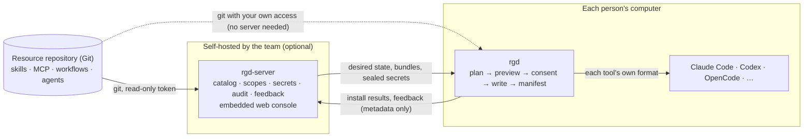

<p align="center">
  <picture>
    <source media="(prefers-color-scheme: dark)" srcset="https://rigdepot.code2rich.com/brand/logo-dark.svg">
    
  </picture>
</p>

<p align="center"><b>English</b> · <a href="README.zh-CN.md">简体中文</a></p>

# Rigdepot

**One depot for your team's AI coding rig — register once, ship to every agent, learn what works.**

Rigdepot keeps a team's skills, MCP servers, workflows and agents in one Git repository, installs them into whichever AI coding tool each person uses, and brings back how well they work.

[](LICENSE)
[](go.mod)
[](#status)
[](https://discord.gg/feGwwqs7x)

<!--
Badges to revisit:
- CI: add a workflow status badge once GitHub Actions runs for this repository.
- Release and Go version: switch to the dynamic shields.io badges once the
  repository is public and the first version is released.
-->

> **Status: design complete, M0 (the command-line core) in development.** Nothing is released yet and no command does real work so far. See [Status](#status) for exactly what exists today.

## Why

Once a team adopts Claude Code, Codex, OpenCode and the like, the same things happen everywhere:

- Every tool is configured separately. The same Jira MCP server has to be set up in five different formats.
- Good skills stay on individual laptops and travel as zip files in chat groups.
- The team has agreed on how to work, but the AI does not know.
- Personal tokens end up pasted into config files, chats and repositories.
- Nobody knows which shared resources are used, and which ones keep failing.
- Switching tools means starting over.

None of this is a defect of any one tool. The tools live on individual machines, and engineering is a team activity.

## What it does

Four things, and nothing else:

| | |
| --- | --- |
| **One place for resources** | Skills, MCP servers, workflows, agents and knowledge bases live in a Git repository, go through code review and are released in versions. Intake checks stop credentials and dangerous commands. Personal secrets are injected on your own machine only. |
| **Standard workflows, delivered** | Resources are organised by engineering stage, from requirements to operations, with three policy levels: required, recommended, optional. A workflow lets the AI follow the team's steps and stop at its checkpoints. |
| **A feedback loop** | Usage insight from metadata only, friction rate, issues raised automatically from error rates, quality scores. |
| **Independent of any agent tool** | Write a resource once; adapters translate it into each tool's own format. A form a tool does not support is downgraded to one it does, and you are told. Switching tools does not lose what the team has built up. |

### Your computer is yours

Rigdepot edits the configuration of other tools on your machine, so these are rules, not features:

- **Preview before anything is written.** `rgd sync --plan` lists every file and every config entry it would touch.
- **Everything written can be undone.** Each write is recorded in a local manifest. `rgd uninstall` reverts exactly what the manifest lists and touches nothing else.
- **No silent changes to global configuration.** Only prefixed entries are added or removed, after a backup and after asking you. A value you set yourself is never overwritten.
- **The platform does not look at content.** No prompts, code, call arguments or results are collected. It does not read other tools' credentials to identify you.

It also works without a server: the command line can sync straight from a Git repository (`rgd sync --repo <url>`). The server adds product scopes, personal secrets, review, audit and insight.

## Architecture

Two Go programs in one repository, released together under one version:

- **`rgd`** runs on each person's computer. It reads resources, works out what to write into each tool, shows you, writes after you agree, records every write and can undo all of it. It carries no database driver and no web assets.
- **`rgd-server`** is self-hosted by the team. It manages who may use what, releases, personal secrets, audit and feedback, and serves the embedded web console.



How the code is laid out, and where a given change belongs, is described in [CONTRIBUTING.md](CONTRIBUTING.md#a-map-of-the-repository).

## Status

The project is at the very beginning of its implementation. To be exact about what exists:

| | State |
| --- | --- |
| Product and engineering design | Complete |
| Repository skeleton, development entry point (`go run ./tools/dev`), dependency rule checks, test isolation | Done |
| `rgd`, `rgd-server` | Build for all six targets and answer `--version`. **No other command is implemented.** |
| M0: command-line core | In development |
| Releases, install scripts, Homebrew, Scoop, container image | Not published. The release tooling is in the repository and has only been run locally. |
| CI | Workflows are written but have **not yet run on GitHub Actions**. Until they do, checks are run locally with `go run ./tools/dev check`. |

Everything below that describes installation, commands or deployment describes where the project is going, and says so.

## Quick start

### Install

> Available once the first version is released. Until then, [build from source](#build-from-source).

| Platform | Command |
| --- | --- |
| macOS, Linux | `curl -fsSLO https://raw.githubusercontent.com/code2rich/rigdepot/main/scripts/install.sh`, read it, then `sh install.sh` |
| Windows (PowerShell) | `irm https://raw.githubusercontent.com/code2rich/rigdepot/main/scripts/install.ps1 -OutFile install.ps1`, read it, then `.\install.ps1` |
| Homebrew | `brew install code2rich/tap/rigdepot` |
| Scoop | `scoop bucket add code2rich https://github.com/code2rich/scoop-bucket`, then `scoop install rigdepot` |
| Docker (server only) | `docker pull ghcr.io/code2rich/rigdepot-server` |

The install scripts do one thing: download the `rgd` binary for your platform from GitHub Releases, verify its SHA-256 checksum, put it in place and tell you how to add it to `PATH`. They do not sign you in, sync anything or install a background job. `rgd` never upgrades itself.

### Build from source

This works today. You need Go (the version in [go.mod](go.mod)) and git.

```sh
git clone https://github.com/code2rich/rigdepot.git
cd rigdepot
go build -o rgd ./cmd/rgd
./rgd --version
```

### First sync

> Planned for M0; not implemented yet.

```sh
rgd sync --repo <git url> --plan   # show every file and config entry that would be written
rgd sync --repo <git url>          # write, after asking before any global configuration changes
rgd status                         # what is installed, and whether anything drifted
rgd uninstall                      # revert everything the manifest lists
```

## Deploying the server

> The server arrives with M1. The files in [deploy/](deploy/) and the [Dockerfile](Dockerfile) are in place and build, but today they package a server that only answers `--version`.

The default path is one executable and one data directory. A team of twenty should be able to deploy it within a day.

| Form | For | Database |
| --- | --- | --- |
| Single binary + systemd ([unit](deploy/systemd/rigdepot-server.service)) | One Linux machine, no containers | SQLite (default) |
| Container image ([Dockerfile](Dockerfile)) | Teams already running containers | SQLite on a volume |
| Docker Compose ([compose.yaml](deploy/compose.yaml)) | One command to start; or PostgreSQL through the `postgres` profile | SQLite or PostgreSQL |

- The server targets Linux on amd64 and arm64. It also runs on macOS for development and trials. Windows is not a supported server platform.
- Configuration comes from `RGD_*` environment variables; only `RGD_BASE_URL` is required.
- Two things need a backup: the database and the master key. Keep them in different places.
- HTTPS is normally left to your reverse proxy. Plain HTTP on a non-loopback address is refused by default.

More in [deploy/README.md](deploy/README.md).

## Supported platforms and AI tools

| Program | macOS (amd64, arm64) | Linux (amd64, arm64) | Windows (amd64, arm64) |
| --- | --- | --- | --- |
| `rgd` | Supported | Supported | Supported |
| `rgd-server` | Development and trials only | Supported | Not supported |

"Supported" is the goal for the first release. Today all six targets compile, and the test suite runs on macOS and in a Linux container. Nothing has been verified on a real Windows machine yet.

| AI coding tool | Skills | MCP servers | State |
| --- | --- | --- | --- |
| Claude Code | Planned | Planned | First batch (M0), in development |
| Codex | Planned | Planned | First batch (M0), in development |
| OpenCode | Planned | Planned | First batch (M0), in development |
| Zcode, Kimi CLI, Gemini CLI | — | — | Planned (M2) |

Where each tool keeps its configuration is verified against the real tool, not guessed from documentation. A tool without a verification record gets nothing written into it.

## Roadmap

| Milestone | In one sentence |
| --- | --- |
| **M0 — command-line core** | Without a server, `rgd sync --repo` installs the skills and MCP servers of a resource repository into Claude Code, Codex and OpenCode, with preview, status, drift detection, intake checks and a clean uninstall. |
| **M1 — team server** | A self-hosted server adds the catalog and releases, products and scopes, three roles, sign-in (OIDC, GitLab, local accounts), personal secrets injected on the device, workflows, agents, knowledge bases, basic audit and feedback. |
| **M2 — closing the loop** | Usage insight with each person's consent, friction rate and automatic issue leads, AI review and quality scores, more adapters. |
| **M3 — more optional modules** | Environment resources and gates, a browser extension, SAML / LDAP / SCIM, external secret backends, approval flows, audit and insight export, IM notifications — ordered by what users ask for. |

M0 and M1 together are the first usable version for a team.

## Contributing

Contributions are welcome, and most of them are small: one directory with a few files, plus one line in a registry. Start with [CONTRIBUTING.md](CONTRIBUTING.md); it gets you from a clone to a passing check in ten minutes.

```sh
go run ./tools/dev deps     # download dependencies; the only step that needs the network
go run ./tools/dev check    # every check: format, static analysis, tests, six cross-compiles
```

- No agreement to sign. Commit with `git commit -s` to add a `Signed-off-by` line, which says you agree to the [Developer Certificate of Origin](DCO).
- Everyone taking part is expected to follow the [Code of Conduct](CODE_OF_CONDUCT.md).
- Found a vulnerability? Please report it privately, as described in [SECURITY.md](SECURITY.md).

## Community

- **Discord**: <https://discord.gg/feGwwqs7x> — everyday talk, ideas, progress.
- **Demo site**: <https://rigdepot.code2rich.com> — an interactive prototype of the web console (three roles, three scenarios, all data fictional) and a feedback form.
- **Issues**: bug reports, feature requests and requests for new tool adapters go to [GitHub Issues](https://github.com/code2rich/rigdepot/issues). General questions are better asked on Discord.

## License and trademark

Rigdepot is fully open source under the [Apache License 2.0](LICENSE): you may use it commercially, modify it, deploy it internally, fork it and host it, and the license includes a patent grant. There is no enterprise edition and no paid feature.

The name "Rigdepot" and its logo are not licensed with the code. You may say that your project is based on Rigdepot; a fork that you distribute to others needs a different name and logo. All names in the code come from one file, [brand.json](brand.json), so that renaming a fork is a one-file change.
