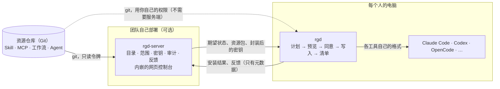

<p align="center">
  <picture>
    <source media="(prefers-color-scheme: dark)" srcset="https://rigdepot.code2rich.com/brand/logo-dark.svg">
    
  </picture>
</p>

<p align="center"><a href="README.md">English</a> · <b>简体中文</b></p>

# Rigdepot

**团队 AI 编码资源的中台：把好用的 Skill、MCP、工作流统一登记，下发到每个人手里的任何 AI 编码工具，再把用得好不好带回来。**

Rigdepot 把团队的 Skill、MCP、工作流和 Agent 放在一个 Git 仓库里，装进每个人正在用的 AI 编码工具，并把使用效果带回来。

[](LICENSE)
[](go.mod)
[](#状态)
[](https://discord.gg/feGwwqs7x)

<!--
以后要改的徽章：
- CI：GitHub Actions 能在这个仓库跑起来之后，加上工作流状态徽章。
- Release 和 Go 版本：仓库公开、发布第一个版本之后，换成 shields.io 的动态徽章。
-->

> **状态：M0（命令行）已经完成，M1（团队服务端）大部分已经做好。** 还没有发布任何版本，想试请从源码构建。现在到底有什么，见[状态](#状态)。

## 为什么

团队用上 Claude Code、Codex、OpenCode 这些工具之后，都会碰到同样的事：

- 每个工具各配各的。同一个 Jira MCP 要在五种格式里各配一遍。
- 好用的 Skill 留在个人电脑里，靠聊天群转发压缩包。
- 团队定了规范，但 AI 不知道。
- 个人令牌明文写进配置文件、贴进对话、提交进仓库。
- 推了一批资源，不知道谁在用、哪个老是报错。
- 换一个工具，一切重来。

这些不是某个工具的缺陷。工具在个人的电脑上，而研发是团队的事。

## 它做什么

只做四件事：

| | |
| --- | --- |
| **资源统一管理** | Skill、MCP、工作流、Agent、知识库放在一个 Git 仓库里，走代码评审，带版本发布。入库检查拦住密钥和危险命令。个人密钥只在你自己的电脑上注入。 |
| **标准流程下发** | 资源按研发环节组织，从需求一直到运维；分必装、推荐、可选三档。工作流让 AI 按团队的步骤走，在检查点停下。 |
| **使用反馈闭环** | 只采元数据的使用洞察、摩擦率、按报错率自动生成的问题线索、质量分。 |
| **与 Agent 工具无关** | 资源只写一次，适配器把它翻译成每个工具自己的格式。工具不支持的形态会降级成它支持的，并告诉你。换工具不丢团队的沉淀。 |

### 你的电脑是你的

Rigdepot 会改你电脑上其他工具的配置，所以下面这些是规矩，不是功能：

- **写之前可预览。** `rgd sync --plan` 列出将要动的每个文件、每处配置。
- **写过的都可撤。** 每一处写入都记在本机清单里。`rgd uninstall` 按清单原样撤销，清单以外的不碰。
- **不静默改全局配置。** 只增删带前缀的条目，改之前先备份、先问你。你自己设的值永不覆盖。
- **平台不看内容。** 不采提问、代码、调用参数和返回内容；不读其他工具的凭证来认人。

没有服务端也能用：命令行可以直接从一个 Git 仓库同步（`rgd sync --repo <地址>`）。服务端增加产品范围、个人密钥、审核、审计和洞察。

## 架构

一个仓库里的两个 Go 程序，同一个版本号、一起发布：

- **`rgd`** 装在每个人的电脑上。它读资源，算出要往每个工具里写什么，给你看，征得同意后写入，记下写过的每一处，并且能全部撤掉。它不带数据库驱动，也不带网页资源。
- **`rgd-server`** 由团队自己部署。它管谁能用什么、版本发布、个人密钥、审计和反馈，网页控制台嵌在它里面。



代码怎么组织、某个改动该去哪，见 [CONTRIBUTING.zh-CN.md](CONTRIBUTING.zh-CN.md#一张地图)，更深入的在 [docs/architecture.zh-CN.md](docs/architecture.zh-CN.md)。

## 状态

M0（命令行）已经完成，M1（团队服务端）也几乎全部做好。还没有发布任何版本：现在要用，请[从源码构建](#从源码构建)。现在有什么，说准确：

| | 状态 |
| --- | --- |
| **不连服务端的 `rgd`** | 能用。`sync --repo`（Git 地址或本地路径）、`sync --plan`、带漂移检测和 `--diff` 的 `status`、`uninstall`、`check`、`doctor`、`enable` / `disable`、`flow next`、`config`、`completion`。 |
| **连服务端的 `rgd`** | 能用。`login` / `logout`（在浏览器里确认确认码）、从服务端目录 `sync` 并上报安装结果、`secret`（个人密钥，按这台电脑封装）、`mcp run` / `serve` / `call`（启动 MCP 时填入密钥，以及把所有 MCP 合成一个的单一入口）、`feedback`。单一入口在 Claude Code 里能连上，Codex 能读回它的条目；OpenCode 还没有核对。 |
| **AI 编码工具** | Claude Code、Codex、OpenCode，每个都在临时主目录里对着真实工具核对过（Claude Code 2.1.330、Codex 0.172.0、OpenCode 2.4.1，macOS arm64）。 |
| **资源类型** | Skill、MCP、工作流、Agent、知识库（一个 Git 目录，用每个人自己的权限拉取）。 |
| **检查规则** | 八条：密钥、危险命令、提示词注入、夹带 `.env`、个人路径、描述、资源之间的重叠、结构。服务端入库时跑的是同一套规则。 |
| **`rgd-server`** | 能用：部署向导、本地账号、OIDC 和 GitLab 登录、邀请和开通申请、产品、成员和三种角色、访问令牌、定时拉取的资源仓库、带草稿、版本、发布和回滚的资源目录、以压缩包上传资源、在网页上登记 MCP、给 `rgd` 下发、个人密钥（加密存放，按设备封装）、问题反馈、站内和邮件通知、带哈希链的审计日志、平台设置、工具适配开关、HTTPS（证书文件或 ACME）、备份、运维命令、指标、在自己的地址上分发 `rgd`。 |
| **`rgd-server` 还没有的** | 无人值守的初始化（`rgd-server setup --from`）。 |
| **网页控制台** | M1 的全部页面，中英文，浅色和深色。 |
| **部署** | Docker Compose（SQLite 或 PostgreSQL）、容器镜像、带 systemd 的 Debian 和 RPM 包。文件在 [deploy/](deploy/)，部署指南是 [docs/deploy.zh-CN.md](docs/deploy.zh-CN.md)。 |
| **版本发布** | 还没有。发布配置（压缩包、安装包、镜像、Homebrew、Scoop）已经在仓库里，只在本地跑过。 |
| **CI** | 工作流已经写好，但**还没有在 GitHub Actions 上跑过**。在那之前，检查在本地用 `go run ./tools/dev check` 跑。 |
| **后面的阶段** | 使用洞察、质量分、更多适配器（M2），见[路线图](#路线图)。 |

## 快速开始

### 安装

> 首个版本发布后可用。在那之前请[从源码构建](#从源码构建)。

| 平台 | 命令 |
| --- | --- |
| macOS、Linux | `curl -fsSLO https://raw.githubusercontent.com/code2rich/rigdepot/main/scripts/install.sh`，看一眼内容，再 `sh install.sh` |
| Windows（PowerShell） | `irm https://raw.githubusercontent.com/code2rich/rigdepot/main/scripts/install.ps1 -OutFile install.ps1`，看一眼内容，再 `.\install.ps1` |
| Homebrew（macOS、Linux） | `brew install --cask code2rich/tap/rigdepot` |
| Scoop（Windows） | `scoop bucket add code2rich https://github.com/code2rich/scoop-bucket`，再 `scoop install code2rich/rigdepot` |
| 从你们组织自己的服务端 | `curl -fsSL https://hub.example.com/install.sh \| sh`，Windows 上 `irm https://hub.example.com/install.ps1 \| iex`，地址换成你们服务端的。控制台的接入指南里有现成的命令。 |

安装脚本只做一件事：下载你这个平台的 `rgd`，校验 SHA-256，放到位（`~/.local/bin`，Windows 上是 `%LOCALAPPDATA%\Programs\rigdepot`），告诉你怎么加进 `PATH`。它不登录、不同步、不装后台任务，也不要管理员权限。`RGD_VERSION` 指定版本，`RGD_INSTALL_DIR` 换目录。你们服务端分发的那份脚本从服务端自己下载，按服务端写进脚本的校验和核对，所以在访问不了外网的网络里也能装。`rgd` 不会自己升级。

服务端的装法不一样，见[服务端部署](#服务端部署)。

### 从源码构建

需要 Go（版本看 [go.mod](go.mod)）和 git。

```sh
git clone https://github.com/code2rich/rigdepot.git
cd rigdepot
go build -o rgd ./cmd/rgd
./rgd version
```

服务端：`go build -o rgd-server ./cmd/rgd-server`。这样构建出来的服务端里是一个占位页，不是网页控制台；带控制台的构建方法见 [CONTRIBUTING.zh-CN.md](CONTRIBUTING.zh-CN.md#网页控制台)。

### 没有服务端：从 Git 仓库同步

仓库里带了一个示例资源仓库 [examples/resources](examples/resources)：一家虚构公司的三个 Skill、两个 MCP、一个工作流、一个 Agent 和一个知识库。先在一个临时主目录里试，这样不会碰到你真实的 AI 工具：

```sh
cd rigdepot
env -u CLAUDE_CONFIG_DIR -u CODEX_HOME -u XDG_CONFIG_HOME HOME="$(mktemp -d)" sh   # 一个主目录是空的 shell

rgd sync --repo . --dir examples/resources --plan     # 列出将要写的每个文件、每处配置；什么都不改
rgd sync --repo . --dir examples/resources            # 写入；改任何工具的全局配置之前会先问你
rgd status --repo . --dir examples/resources          # 装了什么，之后有没有被改过
rgd check examples/resources                          # 入库检查，和服务端跑的一样
rgd uninstall                                         # 按清单全部撤销
exit
```

`--repo` 接受任何你能克隆的 Git 仓库的 https 或 ssh 地址，也接受本地路径；`--dir` 是仓库里放资源的那个目录。用 `rgd config set repo.url <地址>` 存下来，以后就不用每次写。资源按已提交的内容读，用的是你自己的 Git 权限。只有这台电脑上找得到的 AI 工具才会被写入，`--tool` 可以只同步其中几个。

给团队用时，照同样的结构建一个自己的资源仓库（一个 `rigdepot.yaml`，加上 `skills/`、`mcp/` 这样的目录）；照着 [examples/resources](examples/resources) 抄，[examples/resources-broken](examples/resources-broken) 演示了每条检查规则拦什么。

### 有服务端：登录，再同步

有人[部署好服务端](#服务端部署)、在目录里发布了资源之后：

```sh
rgd login https://hub.example.com    # 打印一个确认码；在已经登录的浏览器里确认
rgd sync --plan                      # 服务端要这台电脑装什么，按你所在的产品算
rgd sync
rgd status
```

`rgd login` 把地址记在 `~/.rigdepot/config.toml`，设备令牌放进系统钥匙串，没有钥匙串时放进只有你能读的文件。之后 `rgd sync` 从服务端取资源：全组织的和你所在产品的，默认装必装和推荐的，可选的在 `rgd enable <标识>` 之后装。它会上报装了什么（不带路径、不带内容）；服务端连不上时，按上一次收到的状态工作，不删任何东西。加 `--repo` 仍然从仓库同步。

要个人密钥（比如你自己的 API 令牌）的 MCP，只在你自己的电脑上拿到密钥：用 `rgd secret set <名字>`（或在控制台的「密钥与设备」页）设好，AI 工具的配置里写的是一条命令 `rgd mcp …`，工具启动 MCP 时由它把密钥填进去。密钥不会出现在任何配置文件里。没有服务端时，资源用到的密钥写成对同名环境变量的引用，由你自己设。

## 服务端部署

一个可执行文件加一个数据目录。一个小团队照着 [docs/deploy.zh-CN.md](docs/deploy.zh-CN.md) 应该能在一天内部署完。

| 形态 | 适合 | 数据库 |
| --- | --- | --- |
| Docker Compose（[compose.yaml](deploy/compose.yaml)、[compose.postgres.yaml](deploy/compose.postgres.yaml)） | 想一条命令起来 | SQLite，或者另一个容器里的 PostgreSQL |
| 容器镜像（[Dockerfile](Dockerfile)） | 按自己的方式跑容器的团队 | SQLite 挂一个卷，或者外部的 PostgreSQL |
| Debian 或 RPM 包，带 systemd（[单元文件](deploy/systemd/rigdepot-server.service)） | 一台 Linux 机器，不想用容器 | SQLite，或者外部的 PostgreSQL |

- 服务端的发布目标是 Linux 的 amd64 和 arm64。macOS 上也能跑，用于开发和试用。Windows 不作为服务端的支持平台。
- 配置来自 `RGD_*` 环境变量或一个 TOML 文件，只有 `RGD_BASE_URL` 是必填的。
- 第一次启动时，服务端在日志里打印一个一次性的初始化口令；浏览器里的部署向导凭它创建第一个管理员。
- 要备份的只有两样：数据库和主密钥。两样分开保管。
- HTTPS 通常交给你们的反向代理（[Caddy](deploy/proxy/Caddyfile)、[nginx](deploy/proxy/nginx.conf)）；服务端也可以用证书文件，或者自己去申请证书。在非本机地址上用明文 HTTP 会被拒绝。
- 服务端在自己的地址上给团队的电脑分发 `rgd`，所以装命令行不需要访问外网。

## 支持的平台与 AI 工具

| 程序 | macOS（amd64、arm64） | Linux（amd64、arm64） | Windows（amd64、arm64） |
| --- | --- | --- | --- |
| `rgd` | 支持 | 支持 | 支持 |
| `rgd-server` | 只用于开发和试用 | 支持 | 不支持 |

「支持」是第一个版本的目标。现在六个目标都能编译，测试在 macOS 和 Linux 容器里跑过。还没有在任何一台真实的 Windows 机器上验证过。

| AI 编码工具 | Skill | MCP | 工作流 | Agent | 核对过的版本 |
| --- | --- | --- | --- | --- | --- |
| Claude Code | 支持 | 支持 | 斜杠命令 | 子 Agent | 2.1.330 |
| Codex | 支持 | 支持 | 降级为 Skill | 降级为 Skill | 0.172.0 |
| OpenCode | 支持 | 支持 | 斜杠命令 | 子 Agent | 2.4.1 |
| Zcode、Kimi CLI、Gemini CLI | — | — | — | — | 计划中（M2） |

每个工具的配置放在哪，以在真实工具上核对的结果为准，不照文档猜；每个适配器都记着核对时的版本、系统和日期。没有核对记录的工具，不往它里面写任何东西。工具不能原生接收的形态会降级成它能接收的（工作流变成 Skill），`rgd sync --plan` 会说出来。

## 路线图

| 阶段 | 一句话 |
| --- | --- |
| **M0 命令行内核**（已完成） | 不需要服务端，`rgd sync --repo` 把一个资源仓库里的 Skill 和 MCP 装进 Claude Code、Codex、OpenCode，能预览、看状态、检测改动、做入库检查、干净卸载。 |
| **M1 团队服务端**（进行中） | 自部署的服务端加上目录和版本发布、产品与范围、三种角色、登录（OIDC、GitLab、本地账号）、在本机注入的个人密钥、工作流、Agent、知识库、基础审计和反馈。 |
| **M2 闭环** | 需本人同意的使用洞察、摩擦率和自动生成的问题线索、AI 评审和质量分、更多适配器。 |
| **M3 更多可选模块** | 环境资源与闸门、浏览器插件、SAML / LDAP / SCIM、外部密钥后端、审批流、审计和洞察导出、IM 通知。按使用者的需求排先后。 |

M0 加 M1 是团队能用起来的第一个版本。

## 参与贡献

欢迎贡献。大多数贡献都很小：一个目录里加几个文件，再在登记处加一行。从 [CONTRIBUTING.zh-CN.md](CONTRIBUTING.zh-CN.md) 开始，十分钟能从克隆走到检查通过。

```sh
go run ./tools/dev deps     # 下载依赖。只有这一步联网
go run ./tools/dev check    # 全部检查：格式、静态检查、测试、六个目标的交叉编译
```

- 不需要签任何协议。提交时用 `git commit -s` 带上 `Signed-off-by`，表示你同意[开发者原创声明（DCO）](DCO)。
- 参与的每个人都应遵守[行为准则](CODE_OF_CONDUCT.zh-CN.md)。
- 发现了漏洞？请按 [SECURITY.zh-CN.md](SECURITY.zh-CN.md) 私下报告。

## 社区

- **Discord**：<https://discord.gg/feGwwqs7x>，日常交流、提想法、看进展。
- **Issue**：缺陷、功能建议、新工具适配的请求提到 [GitHub Issues](https://github.com/code2rich/rigdepot/issues)。一般的问题更适合在 Discord 里问。

## 协议与商标

Rigdepot 完全开源，整个仓库采用 [Apache-2.0](LICENSE)：可以商用、修改、内部部署、fork、托管，带专利授权。没有企业版，没有收费功能。

「Rigdepot」这个名称和标志不随代码一起授权。你可以说明你的项目基于 Rigdepot；对外分发的 fork 需要换一个名字和标志。代码里的名字都来自 [brand.json](brand.json) 这一个文件，所以 fork 改名只用改一处。
