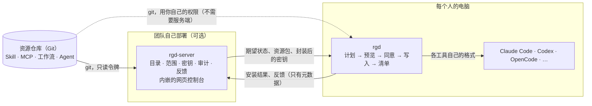

<p align="center">
  <picture>
    <source media="(prefers-color-scheme: dark)" srcset="https://rigdepot.code2rich.com/brand/logo-dark.svg">
    
  </picture>
</p>

<p align="center"><a href="README.md">English</a> · <b>简体中文</b></p>

# Rigdepot

**团队 AI 编码资源的中台：把好用的 Skill、MCP、工作流统一登记，下发到每个人手里的任何 AI 编码工具，再把用得好不好带回来。**

Rigdepot 把团队的 Skill、MCP、工作流和 Agent 放在一个 Git 仓库里，装进每个人正在用的 AI 编码工具，并把使用效果带回来。

[](LICENSE)
[](go.mod)
[](#状态)
[](https://discord.gg/feGwwqs7x)

<!--
以后要改的徽章：
- CI：GitHub Actions 能在这个仓库跑起来之后，加上工作流状态徽章。
- Release 和 Go 版本：仓库公开、发布第一个版本之后，换成 shields.io 的动态徽章。
-->

> **状态：设计完成，M0（命令行内核）开发中。** 还没有发布任何版本，目前没有一条命令能真正干活。现在到底有什么，见[状态](#状态)。

## 为什么

团队用上 Claude Code、Codex、OpenCode 这些工具之后，都会碰到同样的事：

- 每个工具各配各的。同一个 Jira MCP 要在五种格式里各配一遍。
- 好用的 Skill 留在个人电脑里，靠聊天群转发压缩包。
- 团队定了规范，但 AI 不知道。
- 个人令牌明文写进配置文件、贴进对话、提交进仓库。
- 推了一批资源，不知道谁在用、哪个老是报错。
- 换一个工具，一切重来。

这些不是某个工具的缺陷。工具在个人的电脑上，而研发是团队的事。

## 它做什么

只做四件事：

| | |
| --- | --- |
| **资源统一管理** | Skill、MCP、工作流、Agent、知识库放在一个 Git 仓库里，走代码评审，带版本发布。入库检查拦住密钥和危险命令。个人密钥只在你自己的电脑上注入。 |
| **标准流程下发** | 资源按研发环节组织，从需求一直到运维；分必装、推荐、可选三档。工作流让 AI 按团队的步骤走，在检查点停下。 |
| **使用反馈闭环** | 只采元数据的使用洞察、摩擦率、按报错率自动生成的问题线索、质量分。 |
| **与 Agent 工具无关** | 资源只写一次，适配器把它翻译成每个工具自己的格式。工具不支持的形态会降级成它支持的，并告诉你。换工具不丢团队的沉淀。 |

### 你的电脑是你的

Rigdepot 会改你电脑上其他工具的配置，所以下面这些是规矩，不是功能：

- **写之前可预览。** `rgd sync --plan` 列出将要动的每个文件、每处配置。
- **写过的都可撤。** 每一处写入都记在本机清单里。`rgd uninstall` 按清单原样撤销，清单以外的不碰。
- **不静默改全局配置。** 只增删带前缀的条目，改之前先备份、先问你。你自己设的值永不覆盖。
- **平台不看内容。** 不采提问、代码、调用参数和返回内容；不读其他工具的凭证来认人。

没有服务端也能用：命令行可以直接从一个 Git 仓库同步（`rgd sync --repo <地址>`）。服务端增加产品范围、个人密钥、审核、审计和洞察。

## 架构

一个仓库里的两个 Go 程序，同一个版本号、一起发布：

- **`rgd`** 装在每个人的电脑上。它读资源，算出要往每个工具里写什么，给你看，征得同意后写入，记下写过的每一处，并且能全部撤掉。它不带数据库驱动，也不带网页资源。
- **`rgd-server`** 由团队自己部署。它管谁能用什么、版本发布、个人密钥、审计和反馈，网页控制台嵌在它里面。



代码怎么组织、某个改动该去哪，见 [CONTRIBUTING.zh-CN.md](CONTRIBUTING.zh-CN.md#一张地图)。

## 状态

项目刚开始实现。现在有什么，说准确：

| | 状态 |
| --- | --- |
| 产品设计和工程设计 | 完成 |
| 仓库骨架、开发入口（`go run ./tools/dev`）、依赖规则检查、测试隔离 | 完成 |
| `rgd`、`rgd-server` | 六个目标都能编译，能回答 `--version`。**其他命令都还没有实现。** |
| M0：命令行内核 | 开发中 |
| 版本发布、安装脚本、Homebrew、Scoop、容器镜像 | 没有发布。发布用的工程文件已经在仓库里，只在本地跑过。 |
| CI | 工作流已经写好，但**还没有在 GitHub Actions 上跑过**。在那之前，检查在本地用 `go run ./tools/dev check` 跑。 |

下文里讲安装、命令和部署的部分，讲的是项目要去的方向，每一处都注明了。

## 快速开始

### 安装

> 首个版本发布后可用。在那之前请[从源码构建](#从源码构建)。

| 平台 | 命令 |
| --- | --- |
| macOS、Linux | `curl -fsSLO https://raw.githubusercontent.com/code2rich/rigdepot/main/scripts/install.sh`，看一眼内容，再 `sh install.sh` |
| Windows（PowerShell） | `irm https://raw.githubusercontent.com/code2rich/rigdepot/main/scripts/install.ps1 -OutFile install.ps1`，看一眼内容，再 `.\install.ps1` |
| Homebrew | `brew install code2rich/tap/rigdepot` |
| Scoop | `scoop bucket add code2rich https://github.com/code2rich/scoop-bucket`，再 `scoop install rigdepot` |
| Docker（只有服务端） | `docker pull ghcr.io/code2rich/rigdepot-server` |

安装脚本只做一件事：从 GitHub Releases 下载你这个平台的 `rgd`，校验 SHA-256，放到位，告诉你怎么加进 `PATH`。它不登录、不同步、不装后台任务。`rgd` 也不会自己升级。

### 从源码构建

这个现在就能用。需要 Go（版本看 [go.mod](go.mod)）和 git。

```sh
git clone https://github.com/code2rich/rigdepot.git
cd rigdepot
go build -o rgd ./cmd/rgd
./rgd --version
```

### 第一次同步

> 计划在 M0 实现，现在还没有。

```sh
rgd sync --repo <git 地址> --plan   # 列出将要写的每个文件、每处配置
rgd sync --repo <git 地址>          # 写入；改全局配置之前会先问你
rgd status                          # 装了什么，有没有被改动过
rgd uninstall                       # 按清单全部撤销
```

## 服务端部署

> 服务端在 M1 实现。[deploy/](deploy/) 里的文件和 [Dockerfile](Dockerfile) 已经就位并且能构建，但现在打包出来的服务端只会回答 `--version`。

默认的路径是一个可执行文件加一个数据目录。目标是一个 20 人的团队能在一天内部署完。

| 形态 | 适合 | 数据库 |
| --- | --- | --- |
| 单个可执行文件 + systemd（[单元文件](deploy/systemd/rigdepot-server.service)） | 一台 Linux 机器，不想用容器 | SQLite（默认） |
| 容器镜像（[Dockerfile](Dockerfile)） | 已经在用容器的团队 | SQLite，挂一个卷 |
| Docker Compose（[compose.yaml](deploy/compose.yaml)） | 想一条命令起来；或者用 `postgres` profile 接 PostgreSQL | SQLite 或 PostgreSQL |

- 服务端的发布目标是 Linux 的 amd64 和 arm64。macOS 上也能跑，用于开发和试用。Windows 不作为服务端的支持平台。
- 配置来自 `RGD_*` 环境变量，只有 `RGD_BASE_URL` 是必填的。
- 要备份的只有两样：数据库和主密钥。两样分开保管。
- HTTPS 通常交给你们的反向代理。在非本机地址上用明文 HTTP 默认会被拒绝。

更多见 [deploy/README.zh-CN.md](deploy/README.zh-CN.md)。

## 支持的平台与 AI 工具

| 程序 | macOS（amd64、arm64） | Linux（amd64、arm64） | Windows（amd64、arm64） |
| --- | --- | --- | --- |
| `rgd` | 支持 | 支持 | 支持 |
| `rgd-server` | 只用于开发和试用 | 支持 | 不支持 |

「支持」是第一个版本的目标。现在六个目标都能编译，测试在 macOS 和 Linux 容器里跑过。还没有在任何一台真实的 Windows 机器上验证过。

| AI 编码工具 | Skill | MCP | 状态 |
| --- | --- | --- | --- |
| Claude Code | 计划中 | 计划中 | 第一批（M0），开发中 |
| Codex | 计划中 | 计划中 | 第一批（M0），开发中 |
| OpenCode | 计划中 | 计划中 | 第一批（M0），开发中 |
| Zcode、Kimi CLI、Gemini CLI | — | — | 计划中（M2） |

每个工具的配置放在哪，以在真实工具上核对的结果为准，不照文档猜。没有核对记录的工具，不往它里面写任何东西。

## 路线图

| 阶段 | 一句话 |
| --- | --- |
| **M0 命令行内核** | 不需要服务端，`rgd sync --repo` 把一个资源仓库里的 Skill 和 MCP 装进 Claude Code、Codex、OpenCode，能预览、看状态、检测改动、做入库检查、干净卸载。 |
| **M1 团队服务端** | 自部署的服务端加上目录和版本发布、产品与范围、三种角色、登录（OIDC、GitLab、本地账号）、在本机注入的个人密钥、工作流、Agent、知识库、基础审计和反馈。 |
| **M2 闭环** | 需本人同意的使用洞察、摩擦率和自动生成的问题线索、AI 评审和质量分、更多适配器。 |
| **M3 更多可选模块** | 环境资源与闸门、浏览器插件、SAML / LDAP / SCIM、外部密钥后端、审批流、审计和洞察导出、IM 通知。按使用者的需求排先后。 |

M0 加 M1 是团队能用起来的第一个版本。

## 参与贡献

欢迎贡献。大多数贡献都很小：一个目录里加几个文件，再在登记处加一行。从 [CONTRIBUTING.zh-CN.md](CONTRIBUTING.zh-CN.md) 开始，十分钟能从克隆走到检查通过。

```sh
go run ./tools/dev deps     # 下载依赖。只有这一步联网
go run ./tools/dev check    # 全部检查：格式、静态检查、测试、六个目标的交叉编译
```

- 不需要签任何协议。提交时用 `git commit -s` 带上 `Signed-off-by`，表示你同意[开发者原创声明（DCO）](DCO)。
- 参与的每个人都应遵守[行为准则](CODE_OF_CONDUCT.zh-CN.md)。
- 发现了漏洞？请按 [SECURITY.zh-CN.md](SECURITY.zh-CN.md) 私下报告。

## 社区

- **Discord**：<https://discord.gg/feGwwqs7x>，日常交流、提想法、看进展。
- **演示站**：<https://rigdepot.code2rich.com>，有网页控制台的在线原型（可切换三种身份和三种场景，演示数据全部虚构）和问题反馈入口。
- **Issue**：缺陷、功能建议、新工具适配的请求提到 [GitHub Issues](https://github.com/code2rich/rigdepot/issues)。一般的问题更适合在 Discord 里问。

## 协议与商标

Rigdepot 完全开源，整个仓库采用 [Apache-2.0](LICENSE)：可以商用、修改、内部部署、fork、托管，带专利授权。没有企业版，没有收费功能。

「Rigdepot」这个名称和标志不随代码一起授权。你可以说明你的项目基于 Rigdepot；对外分发的 fork 需要换一个名字和标志。代码里的名字都来自 [brand.json](brand.json) 这一个文件，所以 fork 改名只用改一处。
